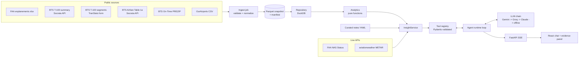

# Airport Investment Intelligence Agent: Design

**One line:** a chat agent that helps investment analysts screen US airports for terminal-expansion opportunities. **Code computes every number** from public FAA/BTS data with a transparent scoring model. **The LLM** picks the analysis, explains the results, and states the assumptions and uncertainty.

---

## 1. Problem framing and scope

The firm earns its return when passenger growth fills new terminal capacity. A strong candidate airport therefore has:
1. **Demand that is growing.**
2. **Existing capacity that is already full** (high load factors, demand outrunning seats).
3. **Visible strain** (taxi-out queues, peak-hour pressure, system delays).
4. **A revenue base large enough to pay back the investment** (scale, pricing power).
5. **No hard constraint that blocks growth anyway.** Examples: a legal passenger cap, a runway bottleneck, no land.

**In scope**
- US commercial-service airports.
- Public, free data only.
- Screening and comparison, not valuation.

**Out of scope (stated in the UI and the answers)**
- Construction costs, financing, and concession contracts.
- Gate counts and terminal square footage. These are not public.
- Investment advice.

---

## 2. Architecture

The system is a **modular monolith with ports-and-adapters**, not microservices. For a one-team, one-day tool, microservices add network hops and deployment overhead without any independent-scaling benefit. Clear module boundaries give the same explainability, and each module can be extracted later. The only real **process** split is where workloads genuinely differ:

| Process | Workload | Why separate |
|---|---|---|
| **Ingestion job** (`app/data/ingest.py`) | Batch ETL from slow government sources (minutes, ~400 MB) | Must never run on the request path |
| **API + agent** (FastAPI) | Interactive, sub-second analytics + LLM calls | Reads the local replica only |
| **Frontend** (React) | UI | Built into the same container for one-command deployment |

**Layers** (`backend/app/`). Dependencies point one way only, downward.

| Layer | Responsibility | Has I/O? |
|---|---|---|
| `data/connectors/*` | One adapter per external source; shared retry/backoff HTTP client | yes |
| `data/ingest.py`, `validation.py` | Fetch, validate against contracts, write Parquet + `manifest.json`. A failed source keeps its last good snapshot. | yes |
| `data/repository.py` | The only place that knows about storage (DuckDB over Parquet) | read-only |
| `analytics/*` | Features, scores, spill model, rank stability. **Pure, deterministic, unit-tested.** | no |
| `services/insights.py` | Business logic: combines analytics, provenance, assumptions and curated notes | no |
| `agent/tools/*` | LLM-facing contract: argument schemas, validation, UI evidence blocks | no |
| `agent/runtime.py` | The loop: context, LLM, tool calls, grounding check | no |
| `llm/*` | Provider adapters + resilience (retry, failover, offline planner) | yes |
| `api/routes.py` | HTTP/SSE. Also exposes `/api/rankings`, which uses no LLM at all. | yes |

**Why "read from a replica":** the statistical APIs are slow, rate-limited and sometimes down. Answers come from a validated local snapshot, which makes them fast, reproducible and resilient. Only genuinely real-time questions call live APIs. The snapshot is committed (~6 MB), so the demo works offline.

---

## 3. Data sources (all free, no signup)

| Source | Access | Period in snapshot | Used for |
|---|---|---|---|
| FAA Passenger Boarding (Enplanement) data | xlsx | CY2019, CY2022-CY2025 (2025 preliminary) | Scale, growth, recovery vs 2019, hub class |
| BTS T-100 Segment Summary by Origin Airport (`r495-tyji`) | Socrata API | Jan 2019 - Aug 2026 | Passengers, seats, load factor, trailing-12-month (TTM) growth |
| BTS T-100 Segment, all carriers (incl. foreign + cargo) | TranStats form POST | Jan 2025 - Aug 2026 | Route distances, passenger vs freighter, route load factors |
| BTS Consumer Airfare Report Table 1a (`tfrh-tu9e`) | Socrata API | 2023 Q1 - 2026 Q1 | Fare premium, carrier concentration |
| BTS On-Time Performance (reporting carriers) | Monthly zips, aggregated at ingest | Oct 2025 - Sep 2026 | Taxi-out, delays, delay causes, peak-hour movements |
| OurAirports | CSV | current | Names, coordinates, runways >= 4,000 ft |
| FAA NAS Status | live JSON API | real time | Ground stops / delay programs, arrival rate, runway config |
| aviationweather.gov METAR | live JSON API | real time | Flight category (VFR/IFR), ceiling |
| Curated notes (`knowledge/airport_notes.yaml`) | hand-curated, cited | reviewed 2026-11 | Constraints data can't see: SNA passenger cap and curfew, SFO runway spacing, ANC cargo role |

Every number the agent shows carries its **source and period**.

---

## 4. Scoring methodology (deterministic)

### 4.1 Terminal Expansion Opportunity Score (0-100)

`config/scoring.yaml` holds all weights; nothing is hard-coded.

| Pillar (weight) | Metrics (weight within pillar) | Rationale |
|---|---|---|
| **Demand momentum (30%)** | Enplanement CAGR CY22-25 (35%), passenger growth TTM vs prior TTM (35%), CY2025 vs CY2019 (30%) | Is demand growing, both recently and structurally? |
| **Capacity utilization (25%)** | Load factor TTM (60%), passenger growth minus seat growth (40%) | Is current capacity full? Is demand outrunning supply? |
| **Operational strain (20%)** | Avg taxi-out (35%), daily peak-hour movements (25%), departures delayed 15+ (20%), NAS delay per arrival (20%) | Is the facility visibly stressed? |
| **Revenue potential (25%)** | log enplanements (60%), fare premium vs distance-adjusted US norm (40%) | Will the investment pay back (scale, pricing power)? |

**Computation**
1. **Peer universe:** 233 US airports with at least 100k annual enplanements.
2. **Normalization:** each metric becomes a **percentile rank** against the peer universe. Percentiles are robust to outliers (e.g. HVN grew 15x vs 2019 after a new airline base), unit-free, and easy to explain ("82nd percentile"). The trade-off is that magnitude is lost, so raw values are always shown next to percentiles.
3. **Aggregation:** pillar score = weighted mean of its metric percentiles; total score = weighted mean of pillar scores.
4. **Missing data:** missing metrics are dropped and the remaining weights re-normalized. **Coverage** (the share of total weight that had data) sets the confidence grade: High >= 90%, Medium >= 70%. Example: HVN has no on-time data, so it is graded Medium.
5. **Rank stability:** 1,000 seeded Dirichlet re-weightings of the pillars around the defaults. The output reads like "BOS ranks #1 in 63% of scenarios". This shows how sensitive the ranking is to subjective weights.
6. **What-if:** analysts can override pillar weights in chat ("weight growth twice as much").
7. **Constraint flags** (legal caps, curfews, land, runway geometry) are shown **next to** the score, never folded into it. The analyst sees the trade-off instead of a hidden penalty.

**Fare premium:** fit `log(fare) = a + b*log(distance)` across all US markets (passenger-weighted, last 4 quarters). An airport's premium is the passenger-weighted mean residual of its markets. A persistent premium signals scarce supply.

### 4.2 Congestion Index (0-100, higher = more congested)

Percentile composite:

| Metric | Weight |
|---|---|
| Taxi-out | 25% |
| Peak-hour movements per runway | 20% |
| Departure delay rate | 15% |
| Arrival delay rate | 15% |
| NAS delay per arrival | 15% |
| Cancellation rate | 10% |

When a curated passenger cap exists, the tool also returns cap utilization (SNA is at about 91% of its 12.2M cap).

### 4.3 Route mix / long-haul share

Departures are banded by segment great-circle distance:
- **Short:** under 700 mi
- **Medium:** 700-3,000 mi
- **Long:** 3,000 mi or more (configurable)

Results are reported separately for **all flights, passenger aircraft, and freighters**, and at alternative thresholds (2,000 / 3,000 / 4,000 mi), because no official definition exists. At ANC the definition matters: **29% of all departures are long-haul, but only 4% of passenger departures are**. ANC is a trans-Pacific cargo hub.

### 4.4 Unmet demand: spill model

Observed passengers are *constrained* demand. Per route-month:
- Assume demand `D ~ Normal(mu, cv*mu)`.
- Observed passengers = `E[min(D, seats)]`.
- Solve for `mu`.
- Spill = `mu - observed`.

The demand variability `cv` is a stated assumption (0.30). Results are also reported at 0.20 and 0.40, giving SFO a range of **0.9M-6.3M** spilled passengers a year around the 2.7M point estimate. Spill is converted to equivalent extra daily departures.

The "why" combines:
- constrained routes (load factor >= 85%)
- fare premium
- delay-cause attribution (NAS share)
- seat vs passenger growth
- live FAA arrival rate
- curated physical constraints

**Counter-signals are reported too.** For example, SFO enplanements are still 5% below 2019, so part of the gap is softer demand.

---

## 5. Where and how AI is used

| Concern | Who does it | Why |
|---|---|---|
| Understanding the question, choosing analyses, sequencing tools | **LLM** (function calling) | Flexible language understanding |
| Entity resolution ("LA", "Santa Ana", "New England") | **Code** (`airport_directory.py`) | Deterministic; ambiguity is surfaced (LA, with BUR/LGB/ONT/SNA as alternatives) |
| Every number, score, rank, model | **Code** (`analytics/`) | Reproducible, testable, auditable |
| Tables, charts, sources in the UI | **Code**, built directly from tool outputs | The LLM cannot misreport them |
| Narrative, reasoning, assumptions, confidence wording | **LLM**, constrained by the system prompt | Clear communication |
| Checking the narrative | **Code**: numeric grounding guardrail | Flags any number in the answer not found in tool outputs |

**Agent runtime** (`agent/runtime.py`):
1. Build context: system prompt with data periods, session focus airports, and trimmed history made of whole turns.
2. Call the LLM with the tool schemas.
3. **Validate every tool call with Pydantic.** Invalid arguments go back to the model, which self-corrects.
4. Run the tools (in parallel, with timeouts).
5. Loop, up to 8 steps.
6. Run the grounding check on the final answer.

Sessions keep the history, so follow-ups like "what about Bangor?" or "weight growth more" work.

**LLM provider chain:**
- Gemini free tier (`gemini-3.5-flash-lite`), then Groq (`gpt-oss-120b`), then Claude.
- One OpenAI-compatible adapter plus an Anthropic adapter, with retry/backoff on 429/5xx and automatic failover.
- **Offline planner (last in the chain):** if every LLM is unavailable, a keyword intent router runs the same tools and assembles the answer from tool summaries. The answer is labeled as offline mode. It degrades gracefully instead of failing.

---

## 6. Key trade-offs

| Decision | Chosen | Alternative | Why |
|---|---|---|---|
| Architecture | Modular monolith + batch ingest process | Microservices | Same separation of concerns, far less overhead; boundaries allow later extraction |
| Data access | Local validated snapshot (replica) | Live API calls per question | Speed, reproducibility, resilience to flaky government sites. Cost: data is as fresh as the last ingest, and every answer states its periods |
| Normalization | Percentile ranks vs national peers | Min-max / z-scores | Robust to outliers and explainable. Cost: loses magnitude, so raw values are shown too |
| Weights | Expert defaults + rank-stability analysis + what-if overrides | "Learned" weights | No ground truth of past investment returns to learn from; transparency beats false precision |
| Constraints | Shown as flags beside the score | Penalty inside the score | Analysts must see *why*; a hidden penalty would be untraceable |
| Terminal capacity | Proxied by load factor, peak-hour movements, taxi-out | Gates / square footage | Not public. Stated as the main limitation |
| LLM | Free tier with failover + offline mode | Single paid model | Meets the brief's free-tier suggestion; resilient to rate limits during demos |
| Number safety | Tool-only numbers + grounding check + UI built from tool data | Trust the LLM | Hallucinated statistics are unacceptable in investment analysis |
| Curated notes | Small cited YAML | RAG over documents | Five airports' constraints don't justify a vector store; the notes are auditable |

---

## 7. Assumptions, uncertainty, scoping (how the system communicates them)

Every tool result carries `assumptions`, `caveats`, `confidence` and `provenance`. The UI shows them in a **Sources & assumptions** tab, and the answer format requires an "Assumptions & caveats" section and a confidence line. Examples:
- "Long-haul >= 3,000 mi (no official definition; 2,000/4,000 shown)."
- "Spill cv = 0.30, range shown."
- "On-time data = reporting carriers' domestic flights only."
- "CY2025 enplanements preliminary."
- "Curated note, source: County of Orange."

---

## 8. Quality

- **41 automated tests** (`make test`). No network or API key is needed.
  - Analytics math checked against closed-form values
  - Spill-model inversion
  - Rank-stability determinism
  - Tool-registry contract (unknown tool, malformed JSON, invalid arguments)
  - Runtime loop with a scripted fake LLM (self-correction, follow-ups, step budget)
  - Provider failover
  - SSE API
  - Integration tests on the real snapshot answering the four brief questions
  - Offline mode
- **Golden-question eval** (`make eval`) against the real LLM: tool choice, grounding, required content. Writes `evals/report.md`.
- **Ingest validation contracts:** required columns, row counts, non-negative values, anchor airports. A failed table keeps its last good snapshot.

## 9. With more time

- Scheduled ingest (Airflow/cron) with data-quality alerts.
- Redis session store.
- Gate and terminal capacity data from airport master plans (RAG over planning PDFs).
- FAA TAF (Terminal Area Forecast) for forward-looking demand.
- Backtest the score against past expansions.
- Per-flight spill using schedule data.
- Auth and multi-user audit log.
- LLM tracing (Langfuse).
